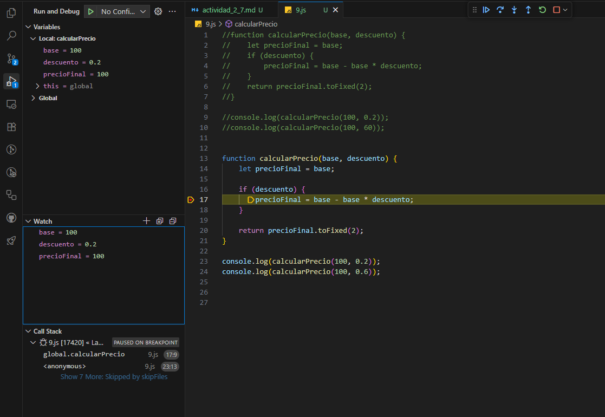

# Actividad 2.7 – Depuración de código

### Ejercicio 1: Variable inexistente

El error es de referencia porque en el console.log pone reslt en vez de result. He cambiado el nombre de la variable y muestra la suma correctamente.

### Ejercicio 2: Comparaciones sospechosas

El error es lógico porque en el if pone => en vez de >=. He cambiado el operador por >= y comprueba bien si la edad es mayor o igual a 18.

### Ejercicio 3: Return of the Jedi

El error es lógico porque el return está comentado y la función no devuelve el resultado de la multiplicación. Quitando las barras // del return muestra 12.

### Ejercicio 4: Names, names...

El error es de referencia porque dentro de la función se utiliza name, pero la variable que recibe se llama nombre. Cambiando name por nombre muestra Hola Ana.

### Ejercicio 5: Out of control

El error es lógico porque en el for se utiliza <= y el bucle da una vuelta de más, intenta acceder a una posición que no existe en el array. Cambiando <= por < la suma da 10.

### Ejercicio 6: Usando expresiones

El error es sintáctico porque en la condición del if se utiliza = en vez de un operador de comparación. He corregido poniendo num % 2 === 0 y así comprueba correctamente si el número es par o impar.

### Ejercicio 7: Callback defectuoso

El error es de referencia porque se utiliza la variable dat, pero esa variable no existe. Cambiando callback(dat) por callback(datos) muestra el array correctamente.

### Ejercicio 8: Evento click sospechoso

El error es de referencia porque la variable se llama msg, pero en el console.log aparece msj. Cambiando msj por msg al pulsar el botón aparece Hola mundo en la consola.

### Ejercicio 9: Cálculo misterioso

El error es lógico porque el descuento se introduce de dos formas diferentes. En el primer caso se pone 0.2, que es un 20 %, pero en el segundo se pone 60, que el programa interpreta como un 6000 %. Cambiando el 60 por 0.6 da como resultado 40.

